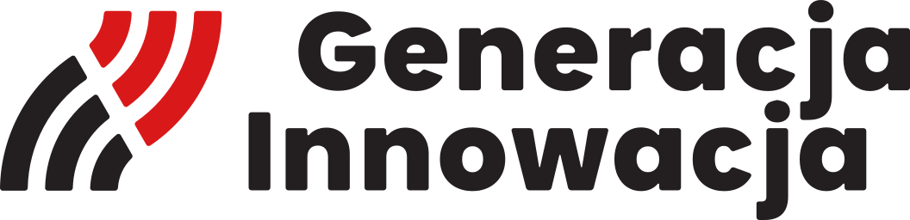
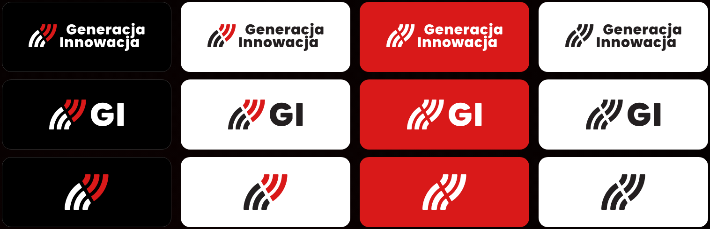
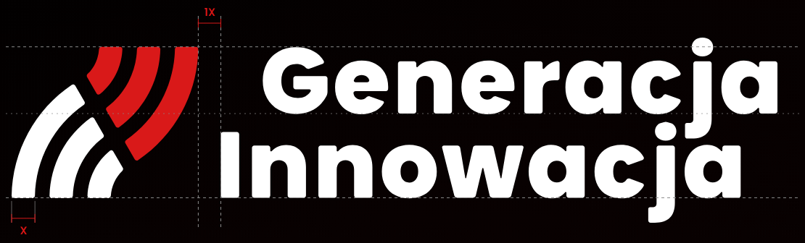
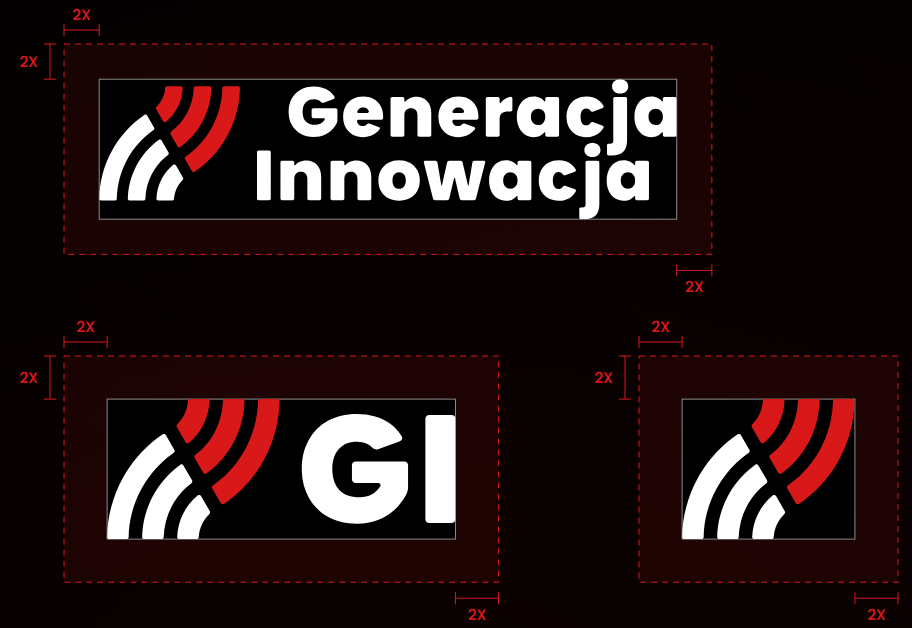

# Logo

> The idea of the sign, its three versions and colour variants, and the measurements that keep it intact.

## Contents
| Section | Description |
|---|---|
| [Idea](#idea) | What the sign stands for |
| [Versions](#versions) | Primary logo, short logo and logomark, and when to use each |
| [Colour variants](#colour-variants) | Which variant goes on which background |
| [Construction](#construction) | The unit X and the proportions of each version |
| [Clear space](#clear-space) | The free area around the logo |
| [Minimum sizes](#minimum-sizes) | The smallest height of each version |

## Idea
<picture>
  <source media="(prefers-color-scheme: dark)" srcset="./logo/gi-logomark-on-dark.svg">
  
</picture>

**Waves of change.** The sign is an image of innovation, of a wave and of change. Its bands are the waves of change that the foundation creates together with young people.

Innovation, wave, change.

## Versions
The sign has three versions with the same construction. Choose by the space available and by whether the full name of the foundation already appears nearby.

### Primary logo
<picture>
  <source media="(prefers-color-scheme: dark)" srcset="./logo/gi-primary-on-dark.svg">
  
</picture>

Wherever there is room: documents, the website, presentations, print and the first contact with the audience.

### Short logo
<picture>
  <source media="(prefers-color-scheme: dark)" srcset="./logo/gi-short-on-dark.svg">
  
</picture>

When the primary logo would be too small or too wide: app headers, footers, partner strips, merchandise, and places where the full name of the foundation appears nearby.

### Logomark
<picture>
  <source media="(prefers-color-scheme: dark)" srcset="./logo/gi-logomark-on-dark.svg">
  
</picture>

Square formats and very small sizes: the social media avatar, favicon, app icon and watermark.

## Colour variants
Each version of the sign comes in four colour variants. The variant is always chosen to suit the background the sign stands on.

| Variant | Background | Colours | Files |
|---|---|---|---|
| Negative | Dark | White and red | `gi-*-on-dark.svg` |
| Positive | Light | #231F20 and red | `gi-*-on-light.svg` |
| On the brand colour | Red #D91919 | White only | `gi-*-on-red.svg` |
| Monochrome | One-colour print | #231F20 only | `gi-*-mono-black.svg` |

*Columns from the left: negative, positive, on the brand colour, monochrome. Rows: primary logo, short logo, logomark.*

Where one-colour white is needed, use the `gi-*-on-red.svg` files: they are white only.

The colour values are in [Colours](./colours.md), and which backgrounds are allowed is in [Usage](./usage.md#logo-on-backgrounds).

## Construction
The unit of the sign is **X - the width of one band of the sign**. The distances in the logo follow from it and from the lines of the lettering.

**Primary logo**

- The gap between the outline of the sign and the lettering is 1X.
- The top edge of the sign is the cap height of the G in the line "Generacja".
- The bottom edge of the sign is the baseline of the line "Innowacja".
- The sign therefore reaches from the cap height of the G to the baseline of the line "Innowacja".

**Short logo**

- The gap between the sign and "GI" is 1X.
- The lettering is centred on the axis of the sign: the axis of the sign is the axis of "GI".
- The height of the I is 5X.

**Logomark**

- The bands are X wide.
- The height of the logomark is 6.5X.

## Clear space
Leave at least **2X of free space on every side** of the sign. Do not put text, other signs or the edge of the format in this area.

| Version | X | Example |
|---|---|---|
| Primary logo | 1/8 of the logo height | A logo 80 px high: clear space 2X = 20 px |
| Short logo, logomark | 3/20 of the logo height | A logo 80 px high: clear space 2X = 25 px |

The fractions are rounded: a band is 32.18 of the 256 units of height in the primary logo and 39.415 of 256 in the short logo and the logomark, which is why the examples come to 20 px and 25 px.

**Fixed gap.** The gap between the sign and the lettering (1X) is part of the logo - do not change it.

## Minimum sizes
Below these heights the details of the sign run together. Then switch to a smaller version of the sign.

| Version | Screen | Print (height) | Below that |
|---|---|---|---|
| Primary logo | 32 px | 12 mm | Use the short logo |
| Short logo | 20 px | 7 mm | Use the logomark |
| Logomark | 16 px | 5 mm | Do not use the sign |
