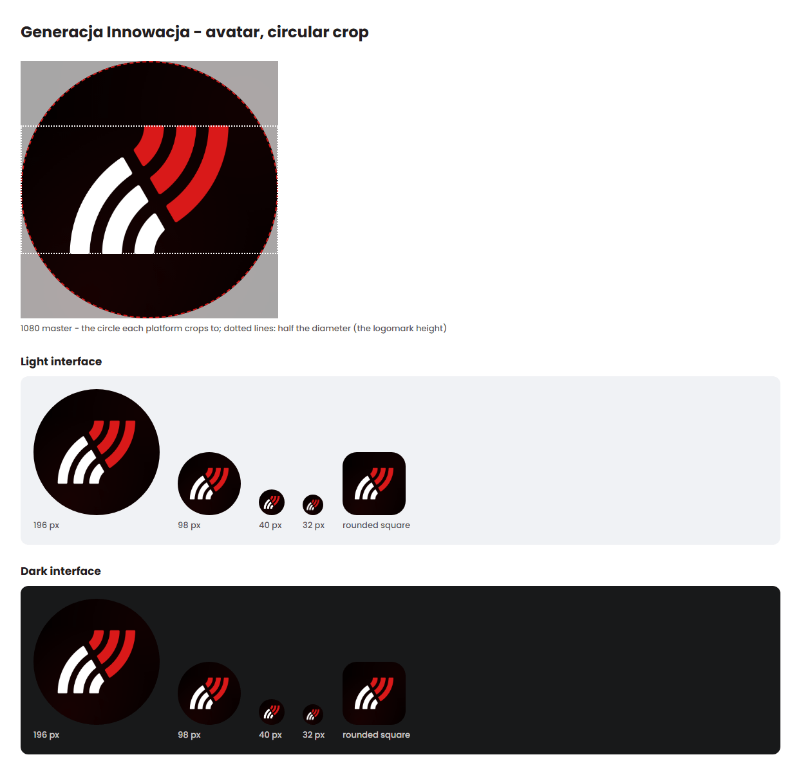

# Marketing package

> Profile pictures, covers, link previews and e-mail signatures for the channels of the foundation and of myPolitics, made from the logo files without changing them.

Everything here is built from the logo files in [logo](../logo/) and in `mypolitics/assets/visual-identity/logo/`, by the rules of the [Generacja Innowacja](../README.md) and [myPolitics](../../../../mypolitics/docs/visual-identity/README.md) brand books. It holds no photos and no generated imagery: only the logo, Poppins, the brand colours and the faint glow of the foundation's slide template.

The files are ready to upload. Uploading is done by people with admin access to each account; this repository only keeps the files.

## Contents
| Section | Description |
|---|---|
| [Folders](#folders) | Where each kind of file is |
| [How the files are made](#how-the-files-are-made) | The rules every file follows |
| [Which logo variant and why](#which-logo-variant-and-why) | GI negative on black; myPolitics colour or universal blue by audience |
| [Profile pictures](#profile-pictures) | One square master per brand and an export for each platform |
| [Covers and banners](#covers-and-banners) | Sizes, safe areas and what gets cut on a phone |
| [Link preview](#link-preview) | The default picture and the template for a title |
| [E-mail signature](#e-mail-signature) | The logo PNG and the HTML snippet |
| [Uploading](#uploading) | Who uploads and what to check afterwards |
| [Sizes and sources](#sizes-and-sources) | The official sizes, checked on 2026-10-18 |
| [Changing the files](#changing-the-files) | What to do when the logo or a platform changes |

## Folders
Both brands have the same layout: [gi](./gi/) and [mypolitics](./mypolitics/).

| Folder | What is in it |
|---|---|
| `avatar/` | The square master (SVG and a 1080 x 1080 PNG) and one PNG per platform, named `<brand>-avatar-<platform>-<size>.png` |
| `cover/` | One SVG master and one PNG per cover or banner, at the size the platform asks for |
| `og/` | The default link preview, the title template (HTML and SVG) and an example made with the template |
| `email/` | The signature logo on white and on black, and the signature snippet |
| `previews/` | Sheets for checking, not for upload: the circular crop, the safe areas, the covers on a phone, the signature |

## How the files are made
- **The logo is the original file, placed and scaled.** Each SVG master contains the logo file's content byte for byte inside an `<svg>` element that only sets its position and size. Nothing is redrawn, recoloured or re-exported from another tool.
- **Black background with the template's glow.** The background is #000000 with the two red radial gradients of the foundation's slide template, scaled to the format. For GI the glow is the brand red #D91919 at twice the template's opacity (8% and 10%); for myPolitics it is the universal blue #0092B8 at three times (12% and 15%), because blue reads darker on black. Either way it stays a hint of colour, not a picture.
- **Avatars follow the brand book's avatar rule.** The logomark is 1/2 of the circle's diameter and centred; it is 540 px high in the 1080 px master. The measured centre of mass of both logomarks is within 0.5% of the centre of their box, so centring the box centres the sign optically. The myPolitics logomark file has its own margin (the bars are 96 of its 168 units), so the file is placed at 1.75 times the bar height, as the myPolitics brand book says.
- **Clear space of 2X is kept** around every logo: 1/4 of the logo height for the GI primary logo, 1/3 for the myPolitics primary logo. Logo heights stay above the minimum sizes (GI primary 32 px, myPolitics primary 24 px, logomarks 16 px). In a 32 px GI avatar the logomark is 16 px high - its minimum - so the GI avatar should not be shown smaller. The myPolitics minimum is measured on the side of the logomark file, which is 28 px in a 32 px avatar.
- **Type is Poppins Medium**, set as outlines in the SVG masters ("gi.org.pl" on the GI covers), so the masters look the same without the font installed. The title in the link preview template is Poppins Bold.
- **PNG files are optimised.** Pictures with the glow are saved losslessly (a 256-colour palette bands the gradient); the e-mail logos and the preview sheets use a palette.

## Which logo variant and why
**Generacja Innowacja** - the negative variant (white and red) on black everywhere: the logomark in avatars, the primary logo on covers with the line "gi.org.pl" under it. Black is the foundation's leading background and the brand book's choice for a black circle. The e-mail logo is the positive variant on white, because most mail is read on white.

**myPolitics** - the brand book gives two families and allows both on black, which has the best contrast for every bar (3.76:1 and up, against the 3:1 rule).

| Family | Used for | Why |
|---|---|---|
| Colour (quiz) | Facebook, Instagram, YouTube, X, GitHub, Discord, Luma, Tally; the default link preview | These accounts are where people come to the quizzes and results |
| Universal blue | LinkedIn; the e-mail signature; the link preview variant for data and press | The universal family is for data, media, press and partners - LinkedIn and e-mail are mostly that |

Both avatar masters are here, so an account whose audience changes can switch without new files. Nothing in the package puts a colour or blue logo on dark teal #003642: there only the white monochrome version is allowed.

## Profile pictures
Upload the file named after the platform. Every platform shows the avatar in a circle or a rounded square; the master is a full square, so both crops work. See [gi-avatar-crops.png](./gi/previews/gi-avatar-crops.png) and [mypolitics-avatar-crops.png](./mypolitics/previews/mypolitics-avatar-crops.png) for the crop at real sizes on light and dark interfaces.

| Platform | GI file | myPolitics file | Size | What the platform says |
|---|---|---|---|---|
| Facebook Page | `gi-avatar-facebook-320.png` | `mypolitics-avatar-facebook-320.png` | 320 x 320 | 320 x 320 for best quality; cropped to a circle; shown at 176 px (computer) and 196 px (phone) |
| Instagram | `gi-avatar-instagram-320.png` | `mypolitics-avatar-instagram-320.png` | 320 x 320 | No size on the Instagram Help Centre; the Facebook Page size is used. Shown in a circle |
| LinkedIn Page | `gi-avatar-linkedin-400.png` | `mypolitics-avatar-linkedin-400.png` (universal blue) | 400 x 400 | Recommended 400 x 400, minimum 268 x 268, up to 3 MB; shown on light and dark backgrounds |
| YouTube | `gi-avatar-youtube-800.png` | `mypolitics-avatar-youtube-800.png` | 800 x 800 | Renders at 98 x 98, up to 15 MB; no upload size given, 800 x 800 leaves room for sharp rendering |
| X | - (GI has no X account linked from gi.org.pl) | `mypolitics-avatar-x-400.png` | 400 x 400 | Recommended 400 x 400, up to 2 MB |
| GitHub organisation | `gi-avatar-github-500.png` | `mypolitics-avatar-github-500.png` | 500 x 500 | About 500 x 500 for the best rendering, under 1 MB; organisations show a rounded square |
| Discord server icon | `gi-avatar-discord-512.png` | `mypolitics-avatar-discord-512.png` | 512 x 512 | No size on Discord's help pages; 512 x 512 is resized by Discord and cropped to a circle |
| Luma calendar | `gi-avatar-luma-512.png` | `mypolitics-avatar-luma-512.png` | 512 x 512 | No avatar size on the Luma help pages; square |
| Tally | `gi-avatar-tally-200.png` | `mypolitics-avatar-tally-200.png` | 200 x 200 | The form logo: 200 x 200 recommended |

Where a platform takes a larger file, the 1080 master (`gi-avatar-1080.png`, `mypolitics-avatar-colour-1080.png`, `mypolitics-avatar-blue-1080.png`) can be uploaded instead.

## Covers and banners
The logo sits in the centre, so every crop the platforms make - all of them cut evenly from the edges or from the top and bottom - keeps it whole. The sheets [gi-cover-safe-areas.png](./gi/previews/gi-cover-safe-areas.png) and [mypolitics-cover-safe-areas.png](./mypolitics/previews/mypolitics-cover-safe-areas.png) draw each safe area over the picture; [gi-covers-on-phone.png](./gi/previews/gi-covers-on-phone.png) and [mypolitics-covers-on-phone.png](./mypolitics/previews/mypolitics-covers-on-phone.png) show what a 390 px wide phone shows, with the profile picture in place.

| File | Size | Logo | Safe area and what is cut |
|---|---|---|---|
| `*-facebook-cover.png` | 1920 x 1080 (16:9) | GI primary, 220 px, with "gi.org.pl"; myPolitics colour, 150 px | Computers show 16:9, phones 2.4:1 (a band 800 px high here); the logo fits in the 851 x 315 shape (711 px high here) too. The profile picture covers about 40 px at the bottom left on phones, away from the logo |
| `*-linkedin-cover.png` | 1512 x 256 | GI primary, 96 px, with "gi.org.pl"; myPolitics universal blue, 70 px | The page logo covers the bottom left. LinkedIn gives no phone safe area; the logo fits in the middle 1024 px |
| `*-youtube-banner.png` | 2560 x 1440 | GI primary, 200 px, with "gi.org.pl"; myPolitics colour, 140 px | TVs show the whole picture; computers a 2560 x 423 band; every device the 1546 x 423 safe area in the middle, which holds the logo with its clear space |
| `mypolitics-x-header.png` | 1500 x 500 | myPolitics colour, 76 px | Up to 60 px may be cut at the top and the bottom; the profile photo covers the bottom left |
| `*-discord-banner.png` | 960 x 540 (16:9) | GI primary, 130 px, with "gi.org.pl"; myPolitics colour, 84 px | The server name is written over the top 48 px, so the logo sits a little below the middle. The banner is shown small at the top of the channel list, hence the large logo. Needs Boost Level 2 |
| `*-discord-invite-background.png` | 1920 x 1080 | None | The background behind the invite pop-up in the middle of the window. Discord recommends no logo or text there, so it is the glow only. Needs Boost Level 1 |

The myPolitics website links to the same Discord server as gi.org.pl, so the GI icon and banner are the ones that server uses. The myPolitics Discord files are for a separate server, if there ever is one.

## Link preview
The picture shown when a link to the site is shared (Open Graph `og:image`, 1200 x 630, 1.91:1).

| File | Use |
|---|---|
| `*-og-default.png` | For pages without a picture of their own: the primary logo in the middle (GI with "gi.org.pl"). myPolitics also has `mypolitics-og-default-blue.png` for data and press pages |
| `*-og-template.html` | The template for a page with a title. Open it in a browser, type the title (and an optional label above it), then save it as JPG or PNG. The title is set in Poppins Bold, from 72 px down to 44 px until it fits in three lines; a one-letter word is kept with the next word. The myPolitics template has a switch for the logo family |
| `*-og-template.svg` | The same layout with the title as a text element, for Figma or Inkscape. It needs Poppins installed |
| `*-og-example*.png` | Examples made with the HTML template |

The template needs an internet connection to load Poppins from Google Fonts; without it the save buttons stay off and the page says why. Prefer the JPG: WhatsApp does not show previews larger than 300 KB, and the PNG from the template is usually larger than that. Keep the title and the logo away from the edges as the template does - a few apps crop the picture to a square in the middle.

## E-mail signature
| File | Use |
|---|---|
| `*-email-logo.png` | The logo for the signature: GI positive variant, myPolitics universal blue positive variant, on white with 2X clear space, at twice the display size (shown at 185 x 60 px and 203 x 50 px) |
| `*-email-logo-dark.png` | The same on black, for a dark signature |
| `*-email-signature.html` | The signature: name, role, logo and the site address (myPolitics also with "myPolitics - projekt Fundacji Generacja Innowacja") |

To set it up in Gmail:

1. Put the logo PNG at a public address - mail clients do not show an image that only exists on a computer.
2. In the HTML file, replace `src="gi-email-logo.png"` (or the myPolitics one) with that address, and `{{NAME}}` and `{{ROLE}}` with the person's name and role.
3. Open the file in a browser, select the signature, copy it and paste it into Gmail's signature editor (Settings, General, Signature).
4. Send a test message to yourself and look at it on a phone and in dark mode.

The text is set in Poppins with Arial as the fallback: most mail clients do not load web fonts, so the reader usually sees Arial. [gi-email-signature.png](./gi/previews/gi-email-signature.png) shows the result with example text.

## Uploading
- **Who:** the people with admin access to each account. The files here are not uploaded automatically, and the assistant that prepared them uploads nothing to the platforms.
- **Where to change the picture:** the profile or page settings of each platform; on Discord, Server Settings, Server Profile (icon and banner) and the invite background in the same place once the boost level allows it.
- **After uploading,** open the profile on a phone and on a computer and check that the logo is whole and centred. Platforms change their layouts without notice; if something is cut, compare with the safe areas above and the date the sizes were checked.

## Sizes and sources
The sizes were checked on **2026-10-18** on the platforms' own help pages:

| Platform | Page | What it gives |
|---|---|---|
| Facebook | [Facebook Page profile picture and cover photo dimensions](https://www.facebook.com/help/125379114252045) | Profile picture 320 x 320, circle, shown at 176 / 196 px; cover 16:9 on computers, 2.4:1 on phones, at least 400 x 150, fastest as an 851 x 315 JPG under 100 KB, PNG better for logos; profile picture overlaps about 40 px on phones |
| Meta for Developers | [Images in link shares](https://developers.facebook.com/docs/sharing/webmasters/images/) | Link images at least 1200 x 630, close to 1.91:1, up to 8 MB |
| LinkedIn | [Page image specifications](https://www.linkedin.com/help/linkedin/answer/a563309) | Logo 400 x 400 (minimum 268 x 268), cover 1512 x 256, PNG or JPG, up to 3 MB |
| LinkedIn | [Image specifications for shared content](https://www.linkedin.com/help/linkedin/answer/a521928) | Link images at least 1200 x 627 |
| YouTube | [Manage your channel branding](https://support.google.com/youtube/answer/10456525) | Profile picture renders at 98 x 98, up to 15 MB; banner 2560 x 1440 recommended, 2048 x 1152 minimum, safe area 1235 x 338 at the minimum size (1546 x 423 at 2560 x 1440), up to 6 MB |
| X | [Help with uploading a profile photo](https://help.x.com/en/managing-your-account/common-issues-when-uploading-profile-photo) | Profile photo 400 x 400, up to 2 MB; header 1500 x 500, about 60 px may be cut at the top and the bottom |
| GitHub | [Profile reference](https://docs.github.com/en/account-and-profile/reference/profile-reference) | Profile picture under 1 MB and 3000 x 3000, about 500 x 500 for the best rendering; the page on organisation profiles gives no size of its own |
| Discord | [Server Banner](https://support.discord.com/hc/en-us/articles/360028716472-Server-Banner-Background-Invite-Splash-Image) | Banner at least 960 x 540, 16:9, top 48 px kept simple, Boost Level 2 |
| Discord | [Server Invite Background](https://support.discord.com/hc/en-us/articles/4415841146391) | 1920 x 1080, JPG or PNG, no logo or text recommended, Boost Level 1 |
| Tally | [Customize your form](https://tally.so/help/customize-your-form) | Logo 200 x 200; WhatsApp skips link images over 300 KB |
| Luma | [Help centre](https://help.luma.com/) | No avatar size given |
| Instagram | [Help Centre](https://help.instagram.com/) | No profile picture size given |

The phone crops of LinkedIn and the size of the profile pictures drawn over the covers on phones are not published; the preview sheets mark them as approximate.

## Changing the files
- **When a logo file changes,** the masters here have to be made again, since each one holds a copy of the logo. The SVG masters can be opened in any vector editor; export the PNGs at the sizes in the tables above.
- **When a platform changes its sizes,** update the tables, the file and the date in [Sizes and sources](#sizes-and-sources).
- **A new platform** needs only a new export of the avatar master at its size, and a row in [Profile pictures](#profile-pictures).
