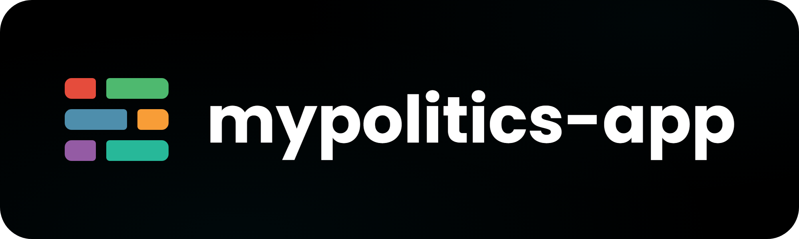

# README header

> The image at the top of every repository's README: the logomark and the repository name on a rounded black card.


## Contents
| Section | Description |
|---|---|
| [Where it applies](#where-it-applies) | Which repositories carry the header and which logomark each uses |
| [The README](#the-readme) | The first lines of the README |
| [The image](#the-image) | File, size, background, logomark and name |
| [Generating a header](#generating-a-header) | The template and the command that renders it |
| [Checks](#checks) | What to look at before committing the image |

## Where it applies
Every repository of the [gi-org-pl](https://github.com/gi-org-pl) organisation starts its README with this header, except the organisation profile (`.github`), whose README is the profile page. A new repository gets its header with its first README.

The logomark depends on the family of the repository:

| Repositories | Logomark | Glow |
|---|---|---|
| Named `mypolitics-*` | myPolitics logomark, colour family: [mypolitics-logomark-colour.svg](../../../mypolitics/assets/visual-identity/logo/mypolitics-logomark-colour.svg) | Blue #0092B8 |
| All others | GI logomark, negative variant: [gi-logomark-on-dark.svg](./logo/gi-logomark-on-dark.svg) | Red #D91919 |



## The README
The first line of the README is the image, then an empty line, then the title:

```markdown


# check-crlf-action
```

- **The relative path is the default.** `.github/image/header.png` renders on GitHub for everyone who can read the repository - public or private, on the default branch, on a pull request branch and in a fork.
- **A private repository always uses the relative path.** An absolute `raw.githubusercontent.com` address of a private repository needs a token, so the image does not render for its readers.
- **A public repository may use the absolute address** `https://raw.githubusercontent.com/gi-org-pl/<repo>/<default branch>/.github/image/header.png`, and must when its README is also shown outside GitHub - by npm or another package registry, where a relative path does not resolve. Athena is published to npm, so it uses this form:

  ```markdown
  
  ```

  The absolute address points to the default branch, so the image shows only after the change is merged.
- **The alternative text is the repository name followed by "header"** ("check-crlf-action header"). Where the title of the README writes the same name with a capital letter, follow the title ("Athena header").
- **Nothing else changes.** The title and everything after it stay as they were.
- **A repository without a README** gets a short one: the header, `# <repository name>` and the description the repository has on GitHub.

## The image
| Property | Value |
|---|---|
| File | `.github/image/header.png` in the repository |
| Size | 2000 x 600 px PNG, shown at 1000 x 300 (2x) |
| Corners | Rounded, radius 80 px; transparent outside the card |
| Background | #000000 with two soft radial glows of the family colour: up to 6% opacity at the bottom, about 30% from the left, and up to 4.5% at the top, about 80% from the left |
| Logomark | The SVG file from this repository, byte for byte - placed and scaled only, never redrawn or recoloured |
| Name | The repository name exactly as GitHub shows it, in lower case where the repository is, in Poppins Bold, white #FFFFFF |

### Proportions
All sizes follow from the height of the visible sign, S. At the standard scale S is 208 px.

| Measure | Value | At the standard scale |
|---|---|---|
| Height of the sign | S | 208 px |
| Cap height of the name | 0.56 S | 116 px |
| Gap between the sign and the name | 0.5 S | 104 px |
| Vertical position | The sign is centred; the middle of the name's cap height is on the middle of the sign. Descenders hang below. | - |
| Horizontal position | The pair - from the left edge of the sign to the last ink of the name - is centred on the card | - |
| Smallest side margin | 160 px | - |

**Long names.** When the pair at the standard scale would come closer than 160 px to the side edges, the whole pair is scaled down together, so the proportions above hold. A name is never shortened, wrapped or set in another weight.

**Clear space.** The proportions keep the [clear space](./logo.md#clear-space) of both brand books. The GI logomark is 6.5X high, so the gap of 0.5 S is 3.25X, more than the 2X required. The myPolitics logomark is 4X high, so the gap is exactly its 2X. Above and below the sign there are 196 px.

**Minimum size.** At the 1x size (half the PNG) the sign of the longest current name is about 55 px high - well above the minimum of 16 px for both logomarks. The template refuses a name so long that the sign would fall below 16 px; such a repository needs a shorter name, not a smaller sign.

## Generating a header
The template [readme-header/header.html](./readme-header/header.html) lays the card out at 1x, and [readme-header/render.cjs](./readme-header/render.cjs) captures it with headless Chromium at device scale 2 with a transparent background. Both work from a checkout of this repository, because the template loads the logomark files from it.

1. Install Playwright and its Chromium once: `npm install playwright && npx playwright install chromium`.
2. Render, from `gi/docs/visual-identity/readme-header/`:

   ```
   node render.cjs <repository-name> --out header.png
   ```

   - `--family gi|mypolitics` overrides the family; by default names starting with `mypolitics` get the myPolitics logomark and all others the GI logomark.
   - `--font <path to Poppins-Bold.ttf>` uses a local font file. Without it, Poppins Bold comes from Google Fonts and the page needs the network; with it, nothing is fetched.
   - `PLAYWRIGHT_MODULE=<path to node_modules/playwright>` uses a copy of Playwright installed elsewhere.

3. Optimise the PNG losslessly if a tool is at hand, for example `oxipng -o 4 header.png`. Do not quantise it to a palette: the glow then turns into bands.
4. Commit the file as `.github/image/header.png` and add the first line to the README.

The script prints the size of the sign and of the font it used, so a header can be checked against the table above.

## Checks
Open the PNG and look at it before committing:

- 2000 x 600 px, corners transparent, no grey or white fringe around the card.
- The right logomark for the family, not cropped, in its own colours.
- The name spelled exactly as the repository, with nothing cut off on the right.
- The pair centred, with at least 160 px to each side edge.
- The glow barely visible - a card that looks red or blue at first sight is wrong.
