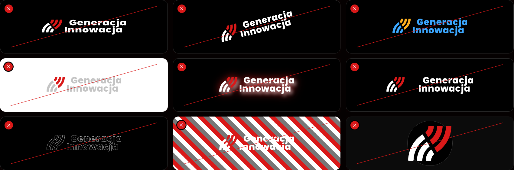

# Usage

> Where the logo may stand, how it goes into an avatar, what must not be done with it, and how it is placed in the most common applications.

## Contents
| Section | Description |
|---|---|
| [Logo on backgrounds](#logo-on-backgrounds) | Allowed backgrounds and the variant for each |
| [Avatars](#avatars) | The logomark in a circle |
| [Incorrect use](#incorrect-use) | What must not be done with the logo |
| [Example applications](#example-applications) | Letterhead, website header, avatar, partner strip |

## Logo on backgrounds
The sign stands on black, white, brand red, or a dark, calm photo - on a photo in the negative variant. On any other background, put one of these colours under the sign.

| Background | Variant | Allowed |
|---|---|---|
| Black | Negative | Yes |
| White | Positive | Yes |
| Brand red #D91919 | On the brand colour | Yes |
| A dark, calm photo | Negative, with the sign in a calm part of the frame | Yes |
| Brand red, with the negative variant | - | No: the red bands disappear. Use the variant on the brand colour |
| Mid-brightness or coloured | - | No: too little contrast. Put black, white or red under the sign |

## Avatars
In an avatar the logomark sits in a circle:

- **The height of the logomark is 1/2 of the diameter of the circle.**
- The logomark is centred optically.
- On a black circle use the negative variant, on a red circle the variant on the brand colour.

Do not push the logomark to the edge of the circle; see [Incorrect use](#incorrect-use).

## Incorrect use
Use the sign only from the original files. Do not redraw it, modify it or reassemble it.

From left to right and top to bottom:

1. Do not stretch or squeeze it.
2. Do not rotate it.
3. Do not change its colours.
4. Do not use light grey on a white background.
5. Do not add shadows or effects.
6. Do not change the gap between the sign and the lettering.
7. Do not turn the sign into an outline.
8. Do not place the sign on a busy background.
9. Do not push the logomark to the edge of the circle - the height of the logomark is 1/2 of the diameter.

## Example applications
The model placement of the sign in the most common places. Each keeps the [clear space](./logo.md#clear-space) of 2X and the [minimum sizes](./logo.md#minimum-sizes).

| Application | Version and variant |
|---|---|
| A4 letterhead | Primary logo, positive |
| Website header | Primary logo, negative |
| Avatar | Logomark in a circle, height = 1/2 of the diameter |
| Partner strip | Short logo, positive; all logos in the strip of equal height |

The mock-ups are on page 13 of the [brand book](./gi-brand-book-2026.pdf).
