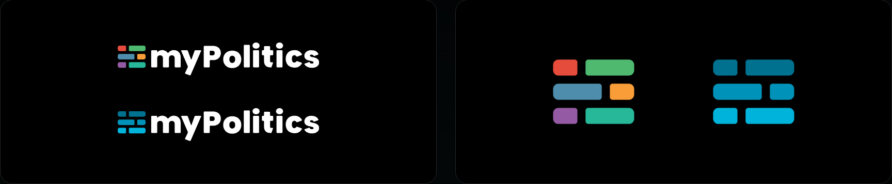

# Visual identity

> The myPolitics logo, colours and typeface: the files and the rules for using them.

These pages are the English version of the myPolitics brand book, [mypolitics-brand-book-2026.pdf](./mypolitics-brand-book-2026.pdf) (the Polish original, 2026). The rules and numbers are the same in both; where they seem to differ, the PDF is the reference.

## Contents
| File | Description |
|---|---|
| [Logo](./logo.md) | The idea of the sign, its two versions and two colour families, colour variants, construction, clear space and minimum sizes |
| [Colours](./colours.md) | The palette with HEX, RGB, CMYK and Pantone values |
| [Typography](./typography.md) | The Poppins typeface and the role of each weight |
| [Usage](./usage.md) | Backgrounds and contrast, incorrect use, the logo in the product and in communication |

## Logo files
The SVG files, kept in `mypolitics/assets/visual-identity/logo/`, are the final files. Use them as they are - do not redraw, re-export or recolour them.

**Primary logo**

| Family | Positive, on a light background | Negative, on a dark background |
|---|---|---|
| Colour (quiz) | [mypolitics-primary-colour-on-light.svg](../../assets/visual-identity/logo/mypolitics-primary-colour-on-light.svg) | [mypolitics-primary-colour-on-dark.svg](../../assets/visual-identity/logo/mypolitics-primary-colour-on-dark.svg) |
| Universal (blue) | [mypolitics-primary-blue-on-light.svg](../../assets/visual-identity/logo/mypolitics-primary-blue-on-light.svg) | [mypolitics-primary-blue-on-dark.svg](../../assets/visual-identity/logo/mypolitics-primary-blue-on-dark.svg) |
| Monochrome | [mypolitics-primary-mono-on-light.svg](../../assets/visual-identity/logo/mypolitics-primary-mono-on-light.svg) | [mypolitics-primary-mono-on-dark.svg](../../assets/visual-identity/logo/mypolitics-primary-mono-on-dark.svg) |

**Logomark**

| Family | On a light background | On a dark background |
|---|---|---|
| Colour (quiz) | [mypolitics-logomark-colour.svg](../../assets/visual-identity/logo/mypolitics-logomark-colour.svg) | the same file |
| Universal (blue) | [mypolitics-logomark-blue.svg](../../assets/visual-identity/logo/mypolitics-logomark-blue.svg) | the same file |
| Monochrome | [mypolitics-logomark-mono-on-light.svg](../../assets/visual-identity/logo/mypolitics-logomark-mono-on-light.svg) | [mypolitics-logomark-mono-on-dark.svg](../../assets/visual-identity/logo/mypolitics-logomark-mono-on-dark.svg) |

The colour and blue logomarks have no lettering, so one file serves both backgrounds. Each file has a transparent background. The logomark file is a 168 x 168 square with the bars, 120 x 96, in the middle; the margin is part of the file. The minimum size of the logomark is measured as the side of this square (see [Minimum sizes](./logo.md#minimum-sizes)).

The files on dark backgrounds are partly white, so they are hard to see in a file preview on a light page.

Ready-made avatars, covers and banners, link previews and the e-mail signature for the myPolitics accounts are in the foundation's [marketing package](https://github.com/gi-org-pl/product/tree/main/gi/docs/visual-identity/marketing-package).

## Names in the Polish original
| English | Polish |
|---|---|
| Primary logo | Znak podstawowy |
| Logomark | Sygnet |
| Colour family (quiz) | Rodzina kolorowa (quiz) |
| Universal family (blue) | Rodzina uniwersalna (niebieska) |
| Positive version | Wersja pozytywowa |
| Negative version | Wersja negatywowa |
| Monochrome version | Wersja monochromatyczna |
| Clear space | Pole ochronne |
