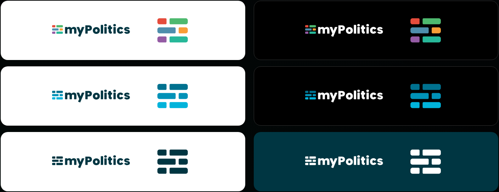
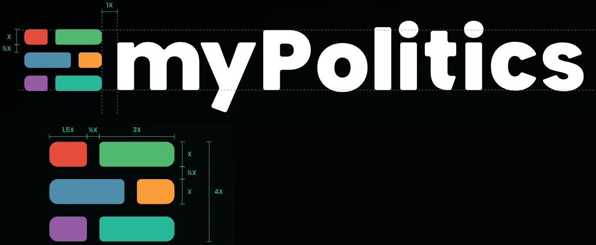
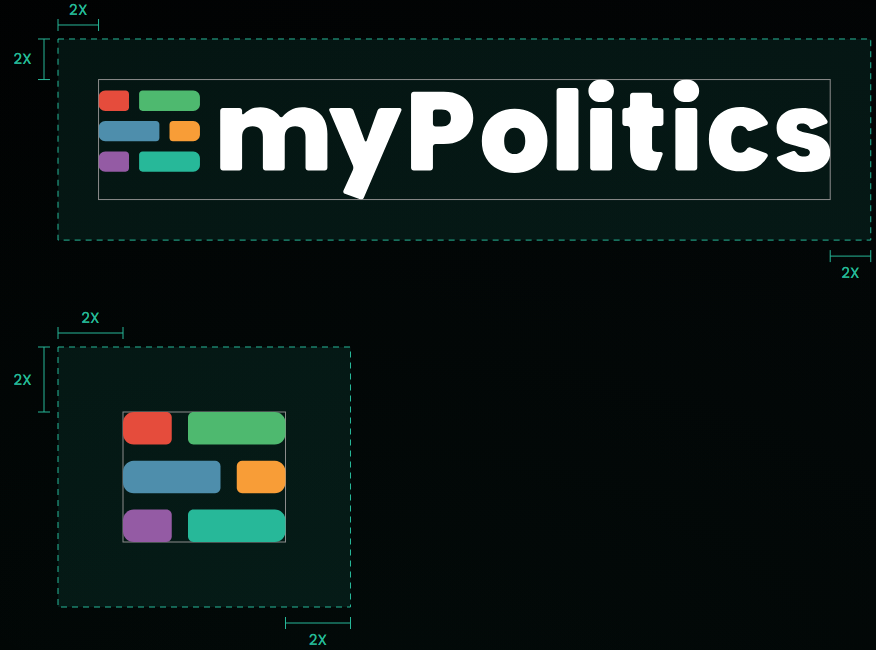

# Logo

> The idea of the sign, its two versions and two colour families, the colour variants, and the measurements that keep it intact.

## Contents
| Section | Description |
|---|---|
| [Idea](#idea) | One sign, three readings |
| [Versions](#versions) | Primary logo and logomark, and when to use each |
| [Colour families](#colour-families) | Colour (quiz) and universal (blue), and when to use each |
| [Colour variants](#colour-variants) | Positive, negative and monochrome, and which background each goes on |
| [Construction](#construction) | The unit X and the proportions of the sign |
| [Clear space](#clear-space) | The free area around the logo |
| [Minimum sizes](#minimum-sizes) | The smallest height of each version |

## Idea
**One sign, three readings.** The logomark is three intersected rectangles - bars split by a gap. They recall the three pillars of myPolitics: quizzes, data and media.

| Pillar | Reading | What it shows | Family |
|---|---|---|---|
| Quizzes | Axes with a position | Each row is an axis and a place on it - this is how a quiz shows a result | Colour |
| Data | A table | Rows and columns of cells - this is how the results of surveys and polls are laid out | Universal |
| Media | A grid of articles | Rectangles of different widths - this is what a page of articles looks like | Universal |

## Versions
The sign has two versions with the same construction and two colour families. Choose the version by the space and the format, and the family by the subject.

| Version | Use |
|---|---|
| Primary logo | Wherever there is room: the app header, the foundation's website, presentations, print and the first contact with the audience |
| Logomark | Square formats and very small sizes: favicon, app icon, social media avatar, and places where the name myPolitics appears nearby |

## Colour families
| Family | Colours | Use |
|---|---|---|
| Colour (quiz) | #E54C3C, #4EB96F, #4E8EAC, #F89D37, #945BA4, #27B899 | Quizzes and results |
| Universal (blue) | #00718F, #0092B8, #00B3DB | Data, media, press, partners |

The values of each colour are in [Colours](./colours.md).

## Colour variants
Each family has a positive and a negative version, and both share one monochrome version. The version is always chosen to suit the background the sign stands on.

| Variant | Background | Lettering | Files |
|---|---|---|---|
| Positive | Light | #003642 | `mypolitics-primary-colour-on-light.svg`, `mypolitics-primary-blue-on-light.svg` |
| Negative | Dark | White | `mypolitics-primary-colour-on-dark.svg`, `mypolitics-primary-blue-on-dark.svg` |
| Monochrome, #003642 | Light; one-colour print | #003642, bars too | `mypolitics-primary-mono-on-light.svg`, `mypolitics-logomark-mono-on-light.svg` |
| Monochrome, white | #003642 and coloured backgrounds | White, bars too | `mypolitics-primary-mono-on-dark.svg`, `mypolitics-logomark-mono-on-dark.svg` |

*Rows from the top: colour (quiz), universal (blue), monochrome. Left: the positive version on a light background. Right: the negative version on a dark background; the monochrome one on dark teal #003642.*

Which backgrounds are allowed, and why, is in [Usage](./usage.md#logo-on-backgrounds).

## Construction
The unit of the sign is **X - the height of one bar**. The gaps between the rows and within each row are ½X; the gap between the logomark and the lettering is 1X.

**Primary logo**

- The top edge of the logomark is the cap height of the P.
- The bottom edge of the logomark is the baseline.
- The gap between the logomark and the lettering is 1X.

**Logomark**

| Element | Rule |
|---|---|
| Bar | Height X = 0.93 of the stem thickness of the letters |
| Rows | Axis and position are split by a gap of ½X: the top and bottom rows are 1.5X + ½X + 3X, the middle row is 3X + ½X + 1.5X |
| Lines of the lettering | The logomark stands on the baseline and reaches the cap height of the P; the rounded ends go about 1.5% beyond these lines |
| Proportions | 5X wide and 4X high |

## Clear space
Leave at least **2X of free space on every side** of the sign. Do not put text, other signs or the edge of the format in this area.

| Version | X | Example |
|---|---|---|
| Primary logo | 1/6 of the logo height | A logo 60 px high: clear space 2X = 20 px |
| Logomark | 1/4 of the height of the bars | Bars 40 px high: clear space 2X = 20 px |

**Fixed gap.** The gap between the logomark and the lettering (1X) is part of the sign - do not change it.

## Minimum sizes
Below these heights the gaps between the bars and the counters of the letters run together.

- The height of the primary logo is measured from the dot of the i to the bottom end of the y.
- The size of the logomark is the side of the square file (as for a favicon).

| Version | Screen | Print (height) | Below that |
|---|---|---|---|
| Primary logo | 24 px | 9 mm | Use the logomark |
| Logomark | 16 px | 5 mm | Do not use the sign |

At 16 px the gap between the bars of the logomark is about 1 px.
