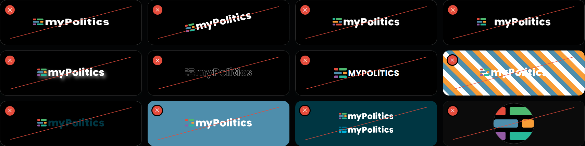
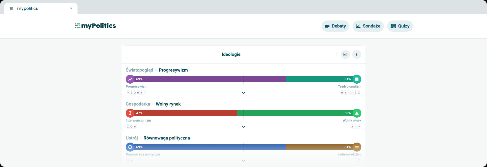

# Usage

> Where the logo may stand and why, what must not be done with it, and how it is used in the product and in communication.

## Contents
| Section | Description |
|---|---|
| [Logo on backgrounds](#logo-on-backgrounds) | Allowed backgrounds and the version for each |
| [Contrast](#contrast) | The contrast of each bar with each background, and the 3:1 rule |
| [Incorrect use](#incorrect-use) | What must not be done with the logo |
| [In the product](#in-the-product) | The app header and the favicon |
| [In communication](#in-communication) | Avatars and the partner strip |

## Logo on backgrounds
Put both colour families on black, on dark calm photos or on white. On dark teal #003642 some of the bars fall below 3:1 - there, and on colours, use the white monochrome version.

| Background | Version | Allowed |
|---|---|---|
| White | Colour, positive | Yes |
| Black | Colour, negative | Yes |
| A dark photo | Colour, negative, with the sign in a calm part of the frame | Yes |
| A colour as the background | White monochrome | Yes |
| Black | Universal, negative - the best contrast | Yes |
| White | Universal, positive - the three shades read as a whole | Yes |
| Dark teal #003642 | Both families: white monochrome only | Yes |
| Dark teal #003642, with the colour versions | - | No: the purple bar is 2.67:1, the top blue bar 2.34:1 |

## Contrast
Contrast of the bars with the background, colour and universal families (WCAG, graphics: minimum 3:1). Values below 3:1 are in bold.

| Background | #E54C3C | #4EB96F | #4E8EAC | #F89D37 | #945BA4 | #27B899 | #00718F | #0092B8 | #00B3DB | Rule |
|---|---|---|---|---|---|---|---|---|---|---|
| Dark teal #003642 | 3.38 | 5.29 | 3.60 | 6.14 | **2.67** | 5.23 | **2.34** | 3.61 | 5.27 | White monochrome only |
| Black #000000 | 5.43 | 8.49 | 5.79 | 9.87 | 4.29 | 8.40 | 3.76 | 5.80 | 8.47 | The best background for both families |
| White #FFFFFF | 3.87 | **2.47** | 3.63 | **2.13** | 4.89 | **2.50** | 5.59 | 3.62 | **2.48** | Allowed - the bars read as a whole |

The first six columns are the colour family, the last three the universal family.

## Incorrect use
Use the sign only from the original files. Do not redraw it, modify it or reassemble it.

From left to right and top to bottom:

1. Do not stretch or squeeze it.
2. Do not rotate it.
3. Do not change the colours or the order of the bars.
4. Do not change the gap between the logomark and the lettering.
5. Do not add shadows or effects.
6. Do not turn the sign into an outline.
7. Do not set the lettering in another typeface or in capitals - always myPolitics.
8. Do not place the sign on a busy background.
9. Do not put the positive version on a dark background.
10. Do not put the colour sign on a colour - use the monochrome version.
11. Do not put the colour or the blue version on #003642 - the bars below 3:1 disappear.
12. Do not push the logomark to the edge of the circle - the width of the logomark is 1/2 of the diameter.

## In the product
The myPolitics app has a light interface, so it uses the primary logo in the positive version of the colour family. In the header the logo is 24 px high - the minimum size.

*A browser tab with the logomark as the favicon (16 px) and the page title, the app header and the results chart. These are the real components of the app; only the sign was swapped.*

## In communication
**Avatars.** In an avatar the width of the logomark is 1/2 of the width of the avatar (the diameter of the circle), and the logomark is centred optically.

- The colour family is for quiz accounts, the universal family for media accounts.
- Always on black or white.
- The width is that of the bars. The logomark file has a margin of its own (the bars are 120 of its 168 units of width), so the file itself is placed at 1.4 times that width.

**Partner strip.** On the black background of gi.org.pl the strip shows the GI short logo and the myPolitics primary logo of the universal family, both in their negative versions, with the line "myPolitics - projekt Fundacji Generacja Innowacja" (myPolitics - a project of the Generacja Innowacja Foundation).

**Data, media, partners.** In materials about data, in the media and with partners, use the universal family.
