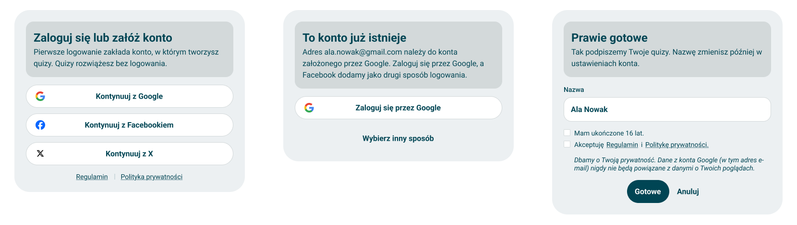
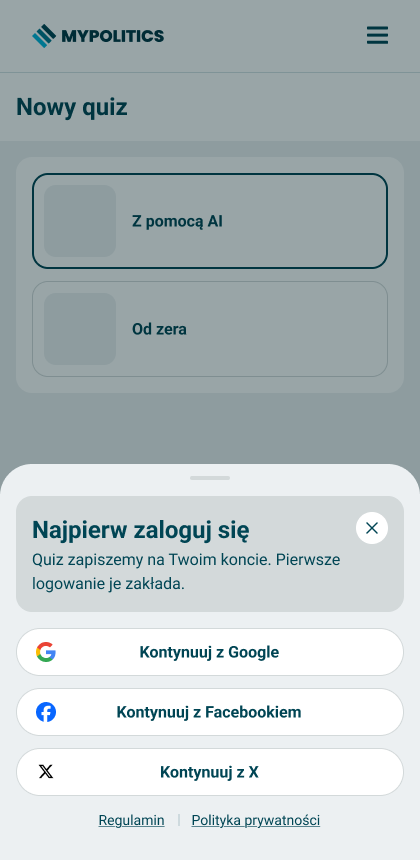

# Sign-in

> Technical specification of signing in and signing up with Google, Facebook or X - the sign-in card and its states, the step that completes a new account, the universal dialog that asks for an account before any action that needs one, the header, and the contract the API has to keep behind them.

Docs: [Sign-in](../../docs/platform/sign-in.md). | Design: [Figma](https://www.figma.com/design/DIInW4qrIxsgXmKbSHukNm/mypolitics-app?node-id=6014-52980)

## Kind
Mixed

## Scope
Two halves, specified together because what the screens promise - "the account is saved only after Gotowe", "we will add Facebook as a second way to sign in" - is only true if the back-end keeps it.

- **Front-end** - five things the person sees:
    - the **sign-in card**: a heading, one line, three provider buttons and the links to the terms and the privacy policy, with its loading, error and "account exists" states;
    - the **"Prawie gotowe" step**: the name, two declarations, "Gotowe" and "Anuluj";
    - the **sign-in page**, the card on a page of its own at `/login`;
    - the **auth dialog**, the same card over any action that needs an account - a modal on a computer and a bottom sheet on a phone - opened by one call that any part of the app can make;
    - the **header**: "Zaloguj się" when signed out, the avatar, the name and the account menu when signed in.
- **Back-end** - the session, the provider sign-in, the pending sign-up that becomes an account only on "Gotowe", the linking of a second provider, and sign-out. The API has none of this today, so this half is the contract for whoever builds it. Until it exists the app runs against a stand-in that behaves as described here, and switching to the API changes nothing the person sees.

What it does not cover, and where that lives:

- **What an account unlocks and what it never binds** - [accounts](../../docs/platform/accounts.md) and [privacy and legal](../../docs/platform/privacy-and-legal.md).
- **The "Moje quizy" and "Konto i logowanie" pages** - not designed yet. The menu shows them once they exist, see "The header".
- **Changing the name, linking or unlinking a provider by hand, deleting the account** - the "Konto i logowanie" page.
- **A second factor** - not designed. Reserved for the moment an author sends a quiz to moderation, see "Rules and constraints".
- **The editor itself** - the quiz editor. This spec only says how "Utwórz quiz" asks for an account before it.
- **Roles and permissions of authors, reviewers and administrators** - accounts. Every signed-in person here is simply signed in.
- **A back-end task** - the repository has no task convention for back-end work. The contract below is the hand-off, and the front-end task that connects the app to it waits for it.

## Data

### Providers
| Provider | Button | Waiting label | Mark | E-mail |
|---|---|---|---|---|
| Google | "Kontynuuj z Google" | "Czekamy na Google…" | The multicolour G | Always given, verified |
| Facebook | "Kontynuuj z Facebookiem" | "Czekamy na Facebooka…" | The blue f in a circle | Usually given; may be missing |
| X | "Kontynuuj z X" | "Czekamy na X…" | The black X | Often missing |

The buttons are always in this order. The marks are the providers' own, in their own colours, and nothing else on the button is the provider's: every button is the app's secondary pill (white, a hairline dark-ash outline, a bold teal label), as the frames draw it.

### The account
| Entity | Data | Meaning | Rules |
|---|---|---|---|
| Account | Identifier | The account | Created on "Gotowe", never before |
| | Display name | What the person's quizzes are signed with | 2 to 50 characters after trimming, see "Invalid and edge input" |
| | Avatar | A picture address, or nothing | The provider's photo when it gives one; otherwise nothing, and the app draws the initials |
| | E-mail | An address, or nothing | Only an address the provider marks as verified. Optional |
| | Age declared | Yes | Always yes on a saved account: the step cannot finish without it |
| | Terms accepted | The date and the version of the terms and of the privacy policy | Recorded on "Gotowe" |
| Linked provider | Provider and the provider's user identifier | A way to sign in to the account | At least one per account. The pair is unique across all accounts |
| Session | The account and when it was started | That this browser is signed in | Held by the API in a cookie the page cannot read. 30 days, extended on use |
| Pending sign-up | Provider, provider's user identifier, suggested name, photo, e-mail | A provider sign-in that has no account yet | Held only in the person's browser, in an encrypted cookie the page cannot read, for 15 minutes. The API stores none of it until "Gotowe", see "Privacy and data handling". Becomes an account on "Gotowe" or is dropped |
| Pending link | Provider and provider's user identifier, and the account the address belongs to | A provider waiting to be linked to that very account | Held the same way, for 15 minutes. Linked only by a sign-in, meant to link, whose identity belongs to that account |

**Identity** is the provider together with the provider's user identifier, never the e-mail. A person who signs in with X and gets no e-mail has a complete account; nothing anywhere requires an address.

**Initials** are the first letter of the first two words of the display name, in capitals ("Ala Nowak" - "AN"), or the first letter alone for a one-word name.

### Texts
Polish source strings. All are drawn in the frames except the ones marked "Set here".

| Element | Text | Source |
|---|---|---|
| Card heading, page | "Zaloguj się lub załóż konto" | Frame |
| Card line, page | "Pierwsze logowanie zakłada konto, w którym tworzysz quizy. Quizy rozwiążesz bez logowania." | Frame |
| Card heading, dialog | "Najpierw zaloguj się" | Frame |
| Card line, dialog | The line of the action, see "Actions that need an account" | Frame for "Utwórz quiz" |
| Links under the buttons | "Regulamin", "Polityka prywatności" | Frame |
| Error, window closed | "Logowanie przerwane" / "Okno {Google / Facebooka / X} zostało zamknięte przed końcem logowania. Spróbuj jeszcze raz." | Frame (Facebook), the other two follow it |
| Error, provider failed | "{Google / Facebook / X} nie odpowiada" / "Nie udało się zalogować przez {Google / Facebooka / X}. Spróbuj za chwilę albo wybierz inny sposób." | Frame (X), the other two follow it |
| Error, the app failed | "Coś poszło nie tak" / "Nie udało się zalogować. Spróbuj jeszcze raz." | Set here |
| Account exists, heading | "To konto już istnieje" | Frame |
| Account exists, line | "Adres {e-mail} należy do konta założonego przez {Google / Facebooka / X}. Zaloguj się przez {Google / Facebooka / X}, a {Google / Facebooka / X} dodamy jako drugi sposób logowania." | Frame (Google owns, Facebook new) |
| Account exists, buttons | "Zaloguj się przez {Google / Facebooka / X}", "Wybierz inny sposób" | Frame |
| Step heading | "Prawie gotowe" | Frame |
| Step line | "Tak podpiszemy Twoje quizy. Nazwę zmienisz później w ustawieniach konta." | Frame |
| Name label | "Nazwa" | Frame |
| Age declaration | "Mam ukończone 16 lat." | Frame |
| Terms | "Akceptuję Regulamin i Politykę prywatności." | Frame. "Regulamin" and "Politykę prywatności" are links |
| Promise | "Dbamy o Twoją prywatność. Dane z konta {Google / na Facebooku / X} (w tym adres e-mail) nigdy nie będą powiązane z danymi o Twoich poglądach." | Frame (Google) |
| Step buttons | "Gotowe", "Anuluj" | Frame |
| Missing name | "Wpisz nazwę, którą podpiszemy Twoje quizy." | Set here |
| Name too short | "Nazwa musi mieć co najmniej 2 znaki." | Set here |
| Age not declared | "Konto mogą założyć osoby, które mają ukończone 16 lat." | Set here |
| Terms not accepted | "Żeby założyć konto, zaakceptuj Regulamin i Politykę prywatności." | Set here |
| Saving failed | "Nie udało się zapisać konta. Spróbuj jeszcze raz." | Set here |
| Sign-out failed | "Nie udało się wylogować. Spróbuj jeszcze raz." | Set here |
| Header, signed out | "Zaloguj się" | Frame |
| Account menu | display name, provider mark and e-mail, "Wyloguj się" | Frame |
| Close the dialog, for assistive technology | "Zamknij" | Set here |

The frames' text reads "Facebook dodamy" in the "account exists" line; the source string declines it ("Facebooka dodamy"), as Polish needs after "dodamy".

## Interface
| Direction | Name | Shape | Notes |
|---|---|---|---|
| Out | Ask for an account before an action | An action key and what to do once signed in | Any part of the app. See "The auth dialog" |
| Out | Guard a page | An action key | For a page that only makes sense signed in. See "The auth dialog" |
| Out | Who is signed in | Not known yet, signed out, or the account (name, avatar, e-mail, providers) | Read by the header and by any feature |
| Out | Sign out | An event | From the account menu |
| In | Session | The account, or none | From the API when the app starts, and after every sign-in, "Gotowe" and sign-out |
| In | Provider sign-in | The provider | The API opens the provider's window and answers with one of the outcomes below |
| In | Complete sign-up | Display name, the two declarations | The API saves the account and starts the session |
| In | Cancel sign-up | An event | The API drops the pending sign-up or the pending link |
| In | Stop a sign-in | An event | The provider window is closed and its answer, if one still arrives, is undone - see "The auth dialog" |
| In | Resume a sign-in | The outcome of a provider sign-in that had to leave the page, or nothing | Asked by the sign-in page when the provider sends the person back |
| In | Terms and privacy addresses | Two links | The app's terms and privacy pages. They open in a new tab, so nothing in progress is lost |

### Outcomes of a provider sign-in
| Outcome | Carries | Meaning |
|---|---|---|
| Signed in | The account | The provider is linked to an account. The session has started |
| New account | Provider, suggested name, photo or nothing, e-mail or nothing | The provider is linked to no account and its e-mail belongs to none. A pending sign-up exists |
| Account exists | The provider that owns the account, the e-mail | The provider is linked to no account, but its verified e-mail belongs to an account made with another provider. A pending link exists |
| Window closed | The provider | The person closed the provider's window before it finished |
| Provider failed | The provider | The provider refused, timed out, answered with an error, or the person denied the permissions |
| Link failed | - | A sign-in meant to link ("Zaloguj się przez ..." after "To konto już istnieje") found nothing to link to: the pending link has expired, or the identity that signed in belongs to another account than the one the address belongs to. No session is started and nothing is linked |
| Failed | - | Anything else: the API is unreachable or answered in a way the app does not know |

## Behaviour

### The sign-in card
| Case | Behaviour |
|---|---|
| The card opens | The heading, the line, the three buttons and the two links. Nothing is focused on the page; in the dialog, focus goes to the dialog, see "The auth dialog" |
| A provider button is pressed | The provider's window opens (or the page goes to the provider, see "Failure modes"). The pressed button keeps its mark, its label becomes the provider's waiting label with a spinner at its right edge; the other two buttons are disabled and drawn at 40% |
| A second press while waiting | Nothing. Only one provider sign-in runs at a time |
| Outcome: signed in | The card's work is done: the page or the dialog finishes, see below |
| Outcome: new account | The card is replaced by the "Prawie gotowe" step |
| Outcome: account exists | The card shows "To konto już istnieje" with one button for the owning provider and "Wybierz inny sposób". The terms links are not shown |
| "Zaloguj się przez ..." pressed | A sign-in with the owning provider, meant to link, with the same waiting state on that button. When it succeeds, the API links the pending provider to the account the address belongs to and the person is signed in |
| Outcome: link failed | Back to three active buttons, with the red "Coś poszło nie tak" box: the person starts over with the provider they wanted to add, which shows "To konto już istnieje" again with a fresh pending link |
| "Wybierz inny sposób" pressed | Back to the card with three buttons. The pending link is dropped |
| Outcome: window closed | Back to three active buttons, with the red "Logowanie przerwane" box above them naming the provider |
| Outcome: provider failed | Back to three active buttons, with the red box naming the provider that failed and pointing to the others |
| Outcome: failed | Back to three active buttons, with the red "Coś poszło nie tak" box |
| Another button pressed while an error is shown | The error disappears as the new attempt starts |
| A link to the terms or the privacy policy | Opens in a new tab |

### The "Prawie gotowe" step
| Case | Behaviour |
|---|---|
| The step opens | The name field holds the name the provider suggested; both boxes are unticked. Nothing is saved yet |
| The provider suggested no name | The field is empty |
| The person edits the name | It is theirs: nothing replaces it |
| "Gotowe" with everything valid | "Gotowe" shows a spinner and the step cannot be changed; the API saves the account and starts the session; the page or the dialog finishes |
| "Gotowe" with something missing | Nothing is sent. Under each missing item its message appears in red, and focus moves to the first of them. A message disappears as soon as its item is fixed |
| Saving failed | The step stays as it was, with "Nie udało się zapisać konta. Spróbuj jeszcze raz." above the buttons. "Gotowe" can be pressed again |
| The pending sign-up has expired when "Gotowe" is pressed | The step closes and the card returns with "Coś poszło nie tak", so the person starts again with a provider |
| "Anuluj" | The pending sign-up is dropped. On the page the card returns; in the dialog the dialog closes, as any cancel does |
| The promise under the boxes | Names the provider the person signed in with |

"Gotowe" is always drawn as the filled main button, as the frames draw it in both the empty and the filled state: the step says what is missing instead of greying the button out.

### The sign-in page
| Case | Behaviour |
|---|---|
| `/login` is opened signed out | The card with the page heading and line, inside the app's header and footer |
| `/login` is opened while signed in | The person is sent on at once, as if they had just signed in |
| The provider sends the person back after a full-page sign-in | The page asks how the sign-in ended and shows that: the person is sent on when signed in; otherwise the card shows "Prawie gotowe", "To konto już istnieje" or the error, exactly as after a provider window |
| Signed in on the page (with or without the step) | The page goes to the address it was given in `next`, or to the home page when there is none |
| `next` is not an address inside the app | It is ignored and the home page is used, so the page can never send anyone to another site |
| "Zaloguj się" in the header | Opens `/login` with `next` set to the page the person was on |

### The auth dialog

| Case | Behaviour |
|---|---|
| An action that needs an account is started while signed in | The action runs at once. No dialog |
| The same action before the session is known | The dialog opens as if signed out. If the session turns out to be signed in, the dialog closes and the action runs, once |
| The same action while signed out | The dialog opens over the page: heading "Najpierw zaloguj się", the action's line, the three buttons and the links, and a close button at the top right |
| On a screen 768 px wide or more | A modal in the middle, over a dimmed page |
| On a narrower screen | A bottom sheet over a dimmed page: full width, rounded top corners, a handle at the top. The handle is a picture of a handle: the sheet closes by its close button, Escape or a press on the dimmed page, not by dragging |
| Signed in through the dialog (with or without the step) | The dialog closes and the action runs, once |
| Closed - close button, Escape, a press on the dimmed page, or "Anuluj" on the step | The dialog closes and nothing else happens: the action does not run, the page is as it was, focus returns to the control that started the action. A pending sign-up is dropped |
| Closed while a provider window is open | The dialog closes and the provider window with it. An answer that still arrives is undone: a pending sign-up or link is dropped, and a session it started is ended, so closing never leaves the person signed in |
| Closed while the step or "To konto już istnieje" is shown | The pending sign-up or link is dropped |
| While "Gotowe" is being saved | The dialog cannot be closed: the close button is disabled and Escape and the dimmed page do nothing, until the API answers |
| A second action asks while the dialog is open | Ignored. The dialog belongs to the first one |
| The person signs in in another tab while the dialog is open | Nothing changes in this tab until it checks the session again; signing in through the dialog then finds the existing session and finishes |
| The provider needs the whole page (see "Failure modes") | The page leaves for the provider and comes back to the sign-in page, with `next` set to the page the dialog was opened on. The sign-in page asks how the provider sign-in ended and carries on from there - signed in, "Prawie gotowe", "To konto już istnieje" or an error - and then goes to `next`. The person presses the action again there: the action itself is not repeated automatically after a full page load |

#### Actions that need an account
An action is named by a key, and each key has its own line - the reason the account is needed, said in terms of what the person was doing. A new action that needs an account adds a key with its line and asks for an account with it; nothing else changes.

| Key | Where it is used | Line |
|---|---|---|
| `create-quiz` | "Stwórz własny" on the home page, and the editor start once the editor exists | "Quiz zapiszemy na Twoim koncie. Pierwsze logowanie je zakłada." |

A line follows the same pattern: what will be kept on the account, then that the first sign-in creates it. "Utwórz quiz" is the action's name in the frames; on the home page today the button reads "Stwórz własny". Until the editor exists, signing in through that button leaves the person on the home page, signed in - the action behind it is still empty, and it starts the editor once the editor is built.

#### Guarded pages
A page that only makes sense signed in (the editor, "Moje quizy") is guarded with an action key. Signed in, it shows. Signed out, the page shows nothing of itself and the dialog opens with the key's line; signing in shows the page, and closing the dialog takes the person back to where they came from, or to the home page when they opened the address directly. Signing out while on a guarded page goes straight to the home page, with no dialog.

### The header
| Case | Behaviour |
|---|---|
| The session is not known yet | The account place in the header is empty, so it never flashes "Zaloguj się" for a person who is signed in |
| Signed out, wide screen | "Zaloguj się" as the filled main pill after the three navigation pills, with a thin divider before it |
| Signed out, phone menu | "Zaloguj się" as the last pill of the menu, drawn like the navigation pills |
| Signed in, wide screen | A pill with the avatar and the display name in place of "Zaloguj się". Pressing it opens the account menu under it |
| The account menu | The avatar, the display name, and under it the mark of the provider the person signed in with and their e-mail (the mark alone when there is no e-mail); then "Wyloguj się". "Moje quizy" and "Konto i logowanie", drawn in the frame between the two, are added when their pages exist |
| The menu closes | On a choice, on Escape (focus back to the pill), or on a press outside it |
| Signed in, phone menu | A row with the avatar and the display name, then "Wyloguj się" as a white pill with a hairline outline |
| "Wyloguj się" | The API ends the session; then the header shows "Zaloguj się" and the person stays on the page, unless the page is guarded, in which case they go to the home page |
| "Wyloguj się" fails (the API cannot be reached) | The person stays signed in, the menu stays open with "Nie udało się wylogować. Spróbuj jeszcze raz." and "Wyloguj się" can be pressed again. The page never shows a person as signed out while the API still holds their session |
| A long display name | Cut with an ellipsis in the header pill; shown whole, wrapped, in the menu |
| No photo | The initials in the avatar circle, as the frames draw it |

## States and lifecycle

### The card
| State | Condition | What is possible in it |
|---|---|---|
| Default | The card has just opened, or "Wybierz inny sposób" was pressed | Any provider; the links |
| Waiting for {provider} | A provider sign-in is running | Nothing on the card; closing the dialog |
| Error: window closed | The last attempt ended with the window closed | Any provider |
| Error: provider failed | The last attempt ended with the provider failing | Any provider |
| Error: failed | The last attempt failed in the app or the API | Any provider |
| Account exists | The provider's e-mail belongs to an account made with another provider | Sign in with the owning provider; go back to the default |
| Prawie gotowe | A new account is pending | Edit the name, tick the boxes, "Gotowe", "Anuluj" |
| Saving | "Gotowe" was pressed and the API has not answered | Nothing, and the dialog cannot be closed |
| Done | Signed in | The page or the dialog finishes |

### The session
| State | Condition | What moves it |
|---|---|---|
| Unknown | The app has started and not heard from the API | The API's answer: signed out or signed in |
| Signed out | No session | A provider sign-in that ends signed in, or "Gotowe" |
| Signed in | A session | "Wyloguj się", or the API saying the session has ended |

## Permissions
| Role | Can | Cannot |
|---|---|---|
| Anyone | Take a quiz, see a result, compare, sign in, sign up | Start an action that needs an account without signing in |
| A person with a pending sign-up | Complete it or cancel it | Anything that needs an account: a pending sign-up is not a session |
| Signed in | Everything that needs an account, sign out | Link a provider that is already linked to another account |

## Rules and constraints
- **No account before "Gotowe".** A provider sign-in that finds no account creates a pending sign-up, nothing more. Nothing about the person is stored beyond it until they have declared their age and accepted the terms.
- **No merging on e-mail.** Two accounts are never joined because they share an address, and a provider is never linked to an account without the owning provider's sign-in in the same flow. Providers verify e-mails differently; a silent merge would hand an account to whoever controls the address on the weaker provider.
- **A provider is linked to at most one account.** The provider and its user identifier are unique.
- **A link goes to the account the address belongs to, and nowhere else.** The pending link names that account; a sign-in meant to link whose identity belongs to another account (a person with two accounts at the same provider who picks the wrong one) links nothing and starts no session.
- **Identity never depends on an e-mail.** An account without one is complete.
- **Taking a quiz never asks for an account**, and no dialog opens on the questionnaire, the result or the comparison.
- **One dialog at a time**, for one action.
- **The action runs at most once**, and only after a successful sign-in.
- **Cancelling restores the page.** The page behind the dialog is not changed by opening and closing it.
- **No Sign in with Apple, no e-mail and password, no magic links.** Adding a provider adds a row to "Providers" and changes nothing else.
- **A second factor is not part of sign-in.** When it comes, it is asked for before "Wyślij do moderacji", not at the door, so the editor stays one step away. The session therefore records when it was started, so that a later check can ask again after a while.

## Invalid and edge input
| Input | Behaviour |
|---|---|
| A name of spaces only | Treated as empty: "Wpisz nazwę, którą podpiszemy Twoje quizy." |
| A name of one character | "Nazwa musi mieć co najmniej 2 znaki." |
| A name longer than 50 characters | The field takes no more than 50 |
| Spaces around or inside the name | Trimmed at both ends; runs of spaces inside become one |
| Line breaks, tabs and control characters in a pasted name | Removed |
| A suggested name over 50 characters | Cut to 50 |
| A suggested name the API sends empty or missing | The field starts empty |
| A display name that is a single word | Its initial alone in the avatar |
| A display name in a script without capitals | The first character as it is |
| A photo address that fails to load | The initials, as if there were no photo |
| No e-mail from the provider | The account is created without one; the account menu shows the provider mark only; the "account exists" case cannot arise for that sign-in |
| An e-mail the provider does not mark as verified | Treated as no e-mail |
| `next` pointing to another site, a protocol other than the app's, or `//` | Ignored: the home page |
| An unknown action key | A programming error: it fails the build's type check. At run time the dialog shows the page's line |

## Privacy and data handling
- **Identity and views stay apart.** The account holds the provider identity, the display name, an optional photo address and an optional e-mail. It is never joined to answers, results, demographics or the respondent code - the separation in [privacy and legal](../../docs/platform/privacy-and-legal.md). The promise on the step says so, naming the provider.
- **Only what is shown is kept.** No birth date (a declaration only), no friends lists, no provider tokens beyond the sign-in itself. The app asks the providers for the basic profile and the e-mail and nothing more.
- **The display name is public** as the author of a quiz. It is suggested, never applied without the person pressing "Gotowe".
- **Nothing is stored before the age declaration.** The provider's profile is needed to sign the person in and to suggest a name, so it is read when the provider answers; until "Gotowe" it is held only in the person's own browser, in an encrypted cookie the page cannot read, which expires after 15 minutes and is deleted by "Anuluj", by closing the dialog and by "Wybierz inny sposób". Deleting it is a request to the API, because the page cannot touch that cookie; when the API cannot be reached, the step still closes, and the cookie stays in the person's own browser until it expires - our servers hold nothing either way. The step does not keep a person waiting for the network to say goodbye. The API keeps no copy and writes nothing about the person - not in a table, a log or a cache - until the age has been declared and the terms accepted. The pending link is held the same way. This is the reading of the rule in [privacy and legal](../../docs/platform/privacy-and-legal.md) that no personal data is processed below 16: what a person under 16 gave the provider passes through the sign-in and is never kept.
- **The page never holds the session.** The session is a cookie the page cannot read; the app learns who is signed in only by asking the API.
- **Sign-out ends the session in the API**, not only in the page. Until the API confirms it, the page keeps showing the person signed in.
- **The stand-in used until the API exists** keeps its pretend session in the tab's session storage and contacts no provider. It is used by the development builds and must not be the sign-in of a public release.

## Failure modes
| Failure | Behaviour |
|---|---|
| The browser blocks the provider's window | The page goes to the provider instead and comes back to the sign-in page, which resumes the sign-in, see "The auth dialog" |
| Signing out cannot reach the API | The person stays signed in, see "The header" |
| The person closes the provider's window | "Logowanie przerwane", naming the provider |
| The provider is down, times out or is denied the permissions | "{Provider} nie odpowiada", pointing to the other ways |
| The API is unreachable during a sign-in | "Coś poszło nie tak" |
| The API is unreachable when the app starts | Treated as signed out: the header shows "Zaloguj się". The next sign-in asks again |
| Saving the account fails | The step stays with "Nie udało się zapisać konta. Spróbuj jeszcze raz." |
| The session ends while the person is in the app (expired, signed out elsewhere) | The next request that needs it finds it gone: the header shows "Zaloguj się", and the next action that needs an account opens the dialog |
| A social app's in-app browser that cannot open the provider | The provider failed message; the other providers stay available |

## Non-functional
- **Keyboard** - every control is reachable and works with the keyboard; focus is drawn as the app's outline. The dialog keeps focus inside itself while open and returns it to the control that opened it when it closes.
- **Assistive technology** - the dialog is a modal dialog named by its heading and described by its line. The waiting button says what it waits for. The error box and the step's messages are announced when they appear. The provider marks are decoration; the label names the provider.
- **Phones** - the bottom sheet fits a 360 px wide screen without scrolling the buttons out of reach, and the keyboard opening over the name field does not hide "Gotowe" (the step scrolls).
- **Motion** - the sheet and the modal appear without movement when the person prefers reduced motion.
- **Languages** - every text is a source string for translation. The provider names are not translated.
- **One component** - the card, the step and the dialog are the same components on the page and in the dialog, so a change to one is a change to all.

## Dependencies
- [Accounts](../../docs/platform/accounts.md) - what the account is for.
- [Privacy and legal](../../docs/platform/privacy-and-legal.md) - the separation of identity and views, and the age of 16.
- The layout's header and footer - the header gains the account place.
- Relied on by: the quiz editor ("Utwórz quiz" and the editor start), "Moje quizy", "Konto i logowanie", moderation, and any later action that needs an account.
