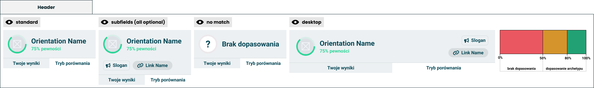

# Header

> Technical specification of the top of the result: one orientation, its confidence, and the two tabs.

Docs: [Header](../../docs/modules/quiz/results/modules/header.md). | Design: [Figma](https://www.figma.com/design/DIInW4qrIxsgXmKbSHukNm/mypolitics-app?node-id=5500-3239)

## Kind
Front-end

## Scope
The block at the top of the result screen: an avatar in a confidence ring, the orientation's name, the confidence, two optional author-written extras, and the tabs that switch between the taker's result and comparison. Unlike the other result modules it does not sit in a [module wrapper](./module-wrapper.md) and has no statistics or info button.

It also defines the **match bands** - the three ranges a confidence or a match falls into. The [archetype](./archetype.md) uses the same bands.

Not covered here:

- **Which orientation leads and how confident the result is** - scoring. The header receives both.
- **What each tab shows** - the result screen, and [comparison modes](../../docs/modules/quiz/results/comparison/comparision-modes.md).
- **The identity block of the generated image** - the [short results card](../../docs/modules/quiz/results/short-results-card.md).
- **Whether an author's slogan or link is acceptable** - moderation.

## Data
| Input | Data | Meaning | Rules |
|---|---|---|---|
| Orientation | Name and image | The orientation leading the group the author pointed the header at | Optional. Absent means no match |
| Confidence | Number, 0-100 | How strongly the answers support this result | Optional |
| Below 50 | `no_match` or `named` | What the header does with an orientation whose confidence is below 50 | Defaults to `no_match` |
| Notice | Text | An author-written line under the result of an orientation named below 50 | Optional |
| Slogan | Text | An author-written line for this orientation | Optional |
| Link | A label and an address | Somewhere the author sends the taker | Optional |
| Active tab | "Your results" or "Comparison" | Which tab is selected | Required |

Name, image, notice, slogan and link are author-supplied and untrusted.

### Match bands
| Band | Range | Meaning |
|---|---|---|
| No match | Below 50 | Nothing clears the bar |
| Partial match | From 50, below 80 | A result, held loosely |
| Match | 80 and above | A result |

The bands are decided on the exact value, not the rounded one. Each band has its own colour, taken from the palette and never from the orientation.

## Interface
| Direction | Name | Shape | Notes |
|---|---|---|---|
| In | Everything in Data | - | Passed in by the result screen |
| Out | Tab selected | The tab that was chosen | The header does not switch content itself |

## Behaviour

### Result
| Case | Behaviour |
|---|---|
| Match or partial match | The orientation's image inside a ring, its name, and the confidence written as a rounded percentage |
| Ring | An arc as long as the confidence, in the band's colour |
| Confidence text | In the band's colour |
| No match, and "Below 50" is `no_match` | A question mark in place of the image, no ring, the "no match" wording in place of the name, and no confidence |
| No match, "Below 50" is `named`, and there is an orientation and a confidence | The closest orientation as for a match: its image inside a ring, its name, and the confidence written as a rounded percentage. The ring and the confidence text are in the colour of the no match band |

### Notice
| Case | Behaviour |
|---|---|
| The closest orientation is named below 50, and a notice is given | The notice, in the colour of the no match band on a tint of it, under the result and its extras and above the tabs |
| The closest orientation is named below 50, and there is no notice | Nothing is drawn |
| Confidence is 50 or more, or the header shows no match | The notice is not drawn, whatever was passed |

### Extras
| Case | Behaviour |
|---|---|
| Slogan present | A labelled chip. Not interactive. A slogan longer than the chip holds wraps onto further lines and is never cut |
| Link present | A button showing the label, which opens the address in a new tab |
| Neither | The row they share is not drawn |
| No match, and no orientation is named | Neither is drawn, whatever was passed. They belong to an orientation, and there is none |
| No match, and the closest orientation is named | Drawn as for a match, since there is an orientation |

### Tabs
| Case | Behaviour |
|---|---|
| Always | Two tabs of equal width under the result: "Your results", then "Comparison" |
| Active tab | Marked as selected |
| A tab pressed | "Tab selected" is raised. The header waits for the new active tab to be passed in |

### Layout
| Case | Behaviour |
|---|---|
| Narrow | Everything stacks: result, then extras, then the notice, then tabs |
| Wide | The extras move to the end of the result's row, slogan above link. The notice stays underneath the row, and the tabs under it, across the full width |

The content is the same in both. Which layout applies depends on the width the header is given.

## Rules and constraints
- **No match is an answer.** It is drawn as deliberately as a match, never as an error or an empty state.
- **The header names the least bad option only when told to.** By default, below 50 the orientation's name and image are not shown, even though they were passed. With "Below 50" set to `named` they are shown, and the notice says that the match is weak.
- **One orientation.** The header has no room for a runner-up or a split result.
- **Confidence is not a score.** It is always written with its word, never as a bare percentage that could be read as a match.

## Invalid and edge input
| Input | Behaviour |
|---|---|
| Orientation absent | No match |
| Confidence absent or not a number | No match |
| Confidence outside 0-100 | Clamped |
| Orientation without an image | A neutral placeholder inside the ring |
| Name longer than the room | Wraps onto a second line, then is truncated; complete for assistive technology |
| Link label longer than the room | Truncated to one line; complete for assistive technology |
| Notice longer than the room | Wraps and is never cut |
| "Below 50" is `named`, and the orientation or the confidence is absent | No match, as without it |
| Link with an empty label | The address is shown as the label |
| Link whose address is not a web address | The link is not drawn |
| Slogan with line breaks | Collapsed to one line |

Nothing here throws. The slogan and the link are someone else's words in the product's most trusted spot, so a malformed one is dropped rather than shown broken.

## Non-functional

### Rendering contexts
The result screen only, at any width.

### Accessibility
- The name is the main heading of the result screen.
- The ring is decorative. The confidence is carried by its text.
- A band is never carried by colour alone: no match changes the wording or, when the closest orientation is named, adds the notice, and a partial match differs from a match by its number.
- The tabs are a tab list, operable from the keyboard, with the selected tab announced.
- The link says that it opens in a new tab.

## Dependencies
**Build order: step 1.** Needs nothing in this folder. It can be built alongside the [single axis chart](./single-axis-chart.md), the [double axis chart](./double-axis-chart.md) and [traits](./traits.md).

Relies on:

- [Header doc](../../docs/modules/quiz/results/modules/header.md) - the idea this implements.

Relied on by:

- [Archetype](./archetype.md) - uses the match bands, so this comes first.
