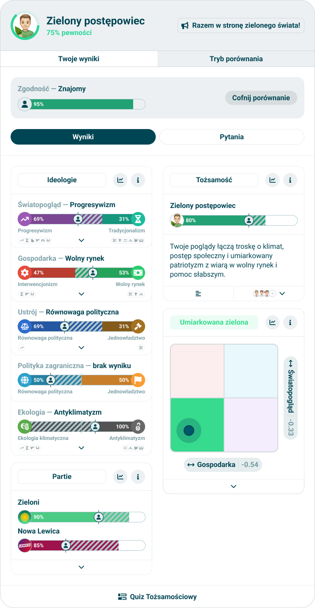

# Results comparison

> Technical specification of the comparison tab of a result: choosing the other side, the agreement bar, the result laid over the taker's, and the answers side by side.

Docs: [Comparison](../../docs/modules/quiz/results/comparison/README.md) - [modes](../../docs/modules/quiz/results/comparison/comparision-modes.md), [agreement info](../../docs/modules/quiz/results/comparison/agreement-info.md), [results comparison](../../docs/modules/quiz/results/comparison/results-comparision.md), [answers comparison](../../docs/modules/quiz/results/comparison/answers-comparision.md). | Design: [modes](https://www.figma.com/design/DIInW4qrIxsgXmKbSHukNm/mypolitics-app?node-id=5514-41702), [agreement](https://www.figma.com/design/DIInW4qrIxsgXmKbSHukNm/mypolitics-app?node-id=5514-52491), [results](https://www.figma.com/design/DIInW4qrIxsgXmKbSHukNm/mypolitics-app?node-id=5514-52656), [answers](https://www.figma.com/design/DIInW4qrIxsgXmKbSHukNm/mypolitics-app?node-id=5514-53568)

## Kind
Front-end

## Scope
What the "Comparison" tab of the [results screen](./results-screen.md) shows: the choice between a friend and an orientation, the bar that names the other side and how much the two agree, the taker's modules with the friend's result laid over them, and the list of questions with both sides' answers.

Not covered here:

- **What a module draws for the other side** - each module spec has its comparison case. This spec only says what each is handed.
- **Who the friend is** - there are no accounts and no names. A friend is a result identifier.
- **Comparing with more than one side** - not a case.
- **A link that opens a comparison** - the comparison is not in the address.

## Data
| Input | Data | Meaning | Rules |
|---|---|---|---|
| The taker's result | As on the results screen | One side | Always present |
| Mode | Friend or orientation | What kind the other side is | Friend unless chosen |
| The friend's result identifier | Text | Typed or pasted by the taker | A result identifier in form |
| The friend's result | As the taker's | The other side, for a friend | Read from the API by its identifier |
| The chosen orientation | An orientation of the quiz | The other side, for an orientation | One of the offered ones |

### Terms
| Term | Meaning |
|---|---|
| The other side | A friend, drawn as a person orientation whose identifier is the friend's result identifier; or an orientation of the quiz |
| Offered orientations | The shown orientations of the quiz that at least one answer of the quiz lists, in the quiz's order. When the quiz's header record lists orientations, only those of them: what the result is named after is what it is compared with. A quiz with no header record, or whose header record lists none, offers all of them |
| An orientation's answers to a question | The possible answers of that question that list the orientation. There may be none, one or several |
| Agreement on a question | Agree, disagree or neither - see the table below |

### Agreement on a question
| Mode | Agree | Disagree | Neither |
|---|---|---|---|
| Friend | Both chose the same answer | Both answered, differently | One of them did not answer |
| Orientation | The taker's answer lists the orientation | The taker answered, some answer of the question lists the orientation, and the taker's does not | The taker did not answer, or no answer of the question lists the orientation |

**The agreement score** is the share of agreeing questions among the questions that agree or disagree, times 100, rounded to a whole number. When no question agrees or disagrees, there is no score.

## Interface
| Direction | Name | Shape | Notes |
|---|---|---|---|
| In | The taker's side | The quiz, the result, the resolved modules | From the results screen |
| In | The API | `GET /v1/result/{identifier}` | For a friend's result |
| Out | The modules | The other side's value for everything a module shows | Only for a friend |

## Behaviour

### Choosing the other side
| Case | Behaviour |
|---|---|
| The tab is opened and no comparison runs | The mode selector: two modes, friend first |
| Friend mode | The taker's own result identifier with a copy control, and a field for the friend's |
| A friend's identifier is entered and it is a result identifier in form | The friend's result is asked for |
| The friend's result is calculated and belongs to the same survey | The comparison starts |
| It is the taker's own identifier | Refused, with a line saying so |
| It belongs to another survey | Refused, with a line saying so |
| It does not exist, is not calculated, or cannot be read | Refused, with a line saying so |
| Orientation mode | A search field and the offered orientations as a list. The search narrows the list by name, ignoring case |
| An orientation is picked | The comparison starts |
| The quiz offers no orientation | Orientation mode is not offered |

### While a comparison runs
| Case | Behaviour |
|---|---|
| Any comparison | The agreement bar on top: the other side's name and image, the agreement score on a one-sided bar, and the control that ends the comparison |
| There is no score | The bar is drawn without a value |
| A friend | Two views under the bar, results first: "Results" and "Questions" |
| An orientation | The questions only, with no choice of view |
| The comparison is ended | The mode selector again, with the mode last used |
| The taker goes to "Your results" and back | The comparison is still running |

### Results, for a friend
Every module of the taker's result is drawn as on "Your results", with the friend's result resolved the same way and handed to it as the other side.

| Module | Handed |
|---|---|
| Single axis | The friend's value of the same orientation |
| Double axis | The friend's start-side value of the same axis |
| Multi axis | The friend's start-side value of every axis, by axis |
| Horizontal bar | The friend's value of every orientation, by orientation. In a list by category, the friend's value inside that category |
| Nolan chart | The friend's four side values |
| Archetype | The friend's value of every archetype |
| Traits | The traits the friend earned |
| Header | Nothing. The header stays the taker's |

A module the taker's result does not draw is not drawn for the friend either.

### Questions
| Case | Behaviour |
|---|---|
| The list | Every question of the quiz, in the quiz's order, each a collapsed row with its text |
| A row | Tinted by its agreement: agree, disagree, or neither |
| A row is opened | Both sides, each named, with what each chose: for the taker and a friend the chosen answer; for an orientation every one of its answers to the question |
| A side with nothing to show | "No answer" |
| An opened row | Marks each answer of the other side with a tick when it is the taker's answer and a cross when it is not |
| The search | Narrows the list by the question's text, ignoring case |
| "Only disagreements" is on | Only the rows that disagree |
| Nothing is left to list | A line saying so |

## States and lifecycle
| State | Condition | What is possible in it |
|---|---|---|
| Choosing | No comparison runs | Picking a mode, entering an identifier, picking an orientation |
| Fetching | A friend's result is on the way | Nothing |
| Refused | The friend's result cannot be used | Entering another identifier |
| Comparing | A comparison runs | The two views, search, the toggle, ending it |

## Copy
| Where | Polish (source) | English |
|---|---|---|
| Mode, friend | Ze znajomym | With a friend |
| Mode, orientation | Z orientacją | With an orientation |
| Own identifier, label | Mój identyfikator wyników | My result identifier |
| Friend's identifier, label | Identyfikator wyników znajomego | A friend's result identifier |
| Friend mode, hint | Wymień się identyfikatorami wyników ze znajomym, aby porównać wzajemnie swoje odpowiedzi. | Swap result identifiers with a friend to compare your answers. |
| Copy control | Skopiuj identyfikator | Copy the identifier |
| Copied | Skopiowano identyfikator. | Identifier copied. |
| Copying is not possible | Nie udało się skopiować. Zaznacz identyfikator i skopiuj go ręcznie. | Copying failed. Select the identifier and copy it by hand. |
| Orientation search | Szukaj po nazwie | Search by name |
| Refused, own | To jest Twój identyfikator. | This is your own identifier. |
| Refused, not an identifier | To nie jest identyfikator wyników. | This is not a result identifier. |
| Refused, other survey | Ten wynik pochodzi z innego quizu. | This result comes from another quiz. |
| Refused, anything else | Nie znaleźliśmy takiego wyniku. | We could not find this result. |
| Agreement, label | Zgodność | Agreement |
| The friend's name | Znajomy | Friend |
| The taker's name | Ty | You |
| End the comparison | Cofnij porównanie | End the comparison |
| View, results | Wyniki | Results |
| View, questions | Pytania | Questions |
| The switch of views, accessible name | Widok porównania | Comparison view |
| Question search | Szukaj | Search |
| Toggle | Tylko niezgodność | Only disagreements |
| No answer | Brak odpowiedzi | No answer |
| A question's agreement, in words | Zgodność, Niezgodność, Brak porównania | Agreement, Disagreement, No comparison |
| Nothing listed | Brak pytań do pokazania. | No questions to show. |

## Rules and constraints
- **One other side at a time.** Starting a comparison ends the one before it.
- **A friend is an identifier.** The app shows no name and no image of its own for a friend: the word "Friend" and the default avatar.
- **An orientation gives answers only.** It has no result to lay over the modules.
- **The same survey.** Two results are compared only when they were handed in for the same survey.
- **Nothing is stored.** The friend's identifier and result live only as long as the page.
- **The score counts questions, not points.** A question weighs the same whatever its category or its answer's weight.

## Invalid and edge input
| Input | Behaviour |
|---|---|
| An identifier with space around it | Trimmed |
| An identifier that is not one in form | No request. The field says it is not an identifier |
| The friend answered questions the taker did not, or the other way round | Those questions are neither |
| An answer of either side names a question or an answer the quiz does not have | Ignored |

## Privacy and data handling
A friend's result holds their political views. It is read only because the taker was given its identifier, it is shown only on the open page, and it is never stored or sent anywhere.

## Failure modes
| Failure | Behaviour |
|---|---|
| The friend's result cannot be read | Refused, as "anything else" |
| A module fails with the other side laid over it | That module is not drawn, as on the results screen |

## Non-functional
- **Accessibility** - the modes and the views are tab lists; a question row is a disclosure; agreement is said in words, never by colour alone.
- **Performance** - one request per friend. Picking an orientation asks for nothing.

## Dependencies
- Relies on the [results screen](./results-screen.md), [result modules configuration](./result-modules-configuration.md) for resolving a result, and every module spec for its comparison case.
- Relies on [universal orientation](./universal-orientation.md) for the friend as a person.
