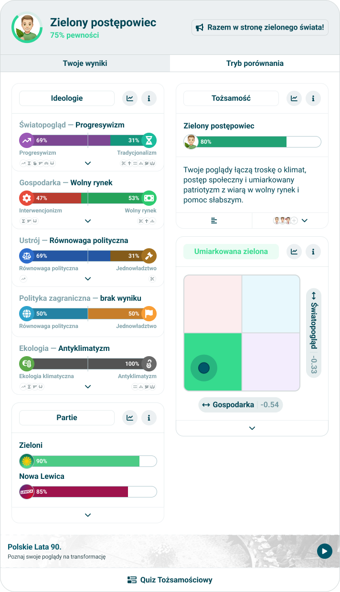

# Results screen

> Technical specification of the screen a result is read on: how it is loaded, what it is composed of, and how its modules are laid out.

Docs: [Results](../../docs/modules/quiz/results/README.md), and [Results configuration](../../docs/modules/quiz/results/configuration.md) for where the modules come from. | Design: [Figma](https://www.figma.com/design/DIInW4qrIxsgXmKbSHukNm/mypolitics-app?node-id=5499-667)

## Kind
Front-end

## Scope
The screen at a result's address: reading the result and its quiz, the header, the two tabs, the modules in their columns, the module's explanation, the quiz name under them, and every state on the way there. It is the first screen of the app that draws a result; until it exists the taker is sent to the old site.

Not covered here:

- **Which modules a quiz has and what each is given** - [result modules configuration](./result-modules-configuration.md).
- **What each module draws** - the module specs.
- **The comparison tab** - [results comparison](./results-comparison.md). This spec only says where it is.
- **The short results card and the image people share** - not built yet.
- **The next quiz** - [follow-up recommendation](../../docs/modules/quiz/results/follow-up-recommendation.md) has no rule for which quiz to offer, so the banner is not drawn yet.
- **Module statistics** - no source exists.
- **Saving a result to an account** - there are no accounts.

## Data
| Input | Data | Meaning | Rules |
|---|---|---|---|
| Result identifier | Text | Which result to show | From the address. A bearer key: whoever has it can read the result |
| Result | The quiz it belongs to, points and maximum per orientation, the answers given, whether it is calculated | What the taker scored | From `GET /v1/result/{identifier}` |
| Quiz | Its name, orientations, axes, categories, questions and result modules | What the result is read against | The survey the result names, from `GET /v1/survey/{identifier}`, in the app's language |
| Result modules | The list of records | What the screen is composed of | From the quiz. For a quiz the API sends no list for, the app's own list for that quiz, when it has one |

- **The result names its quiz version.** The screen reads exactly the survey the result was handed in for, never the latest one of its project, so an old result keeps reading as it did.
- **The declared gender is not in a result.** The API does not send it back, so an orientation with two forms of its name is shown in its default form. A field is asked of the back-end.

### The app's own lists
The API sends no result modules yet. Until it does, the app keeps one list per quiz it knows, in the same record shape, keyed by the survey's identifier. A list from the API wins over the app's own as soon as it is not empty.

| Quiz | Modules, in order | Looks like |
|---|---|---|
| Quiz Tożsamościowy | Header over the identities, naming the closest identity below 50 with a notice. Start column: multi axis "Ideologie" (the axes that have a category, grouped by category, with an explanation). End column, in order: archetype "Tożsamość" (the identities, naming the closest below 50), Nolan chart (the two compass axes), horizontal bar "Partie" (the parties, linked to the leader, saying "Brak najbliższej partii" when the leader is below 50) | The old identity quiz result |
| Barometr Prezydencki 2025 | Header over the candidates, link label "Program". Start column: horizontal bar "Kandydaci" (every candidate, all rows visible). End column: archetype "Prezydent" (the presidential identities), horizontal bar "Kategorie" (the candidates, by category) | The old presidential result |

Every other quiz has no list and reads as not configured.

## Interface
| Direction | Name | Shape | Notes |
|---|---|---|---|
| In | The address | `/results/{result identifier}` | The same path the old site used |
| In | The API | Result and survey | As [session and data](./session-and-data.md) reads a survey; the result is read in full here for the first time |
| Out | The questionnaire | Where the loader sends the taker | The [engaging loader](./engaging-loader.md) goes to this address instead of the old site |

## Behaviour

### Loading
| Case | Behaviour |
|---|---|
| The address is opened | The result is asked for |
| The result is calculated | Its survey is asked for, then the screen is drawn |
| The result exists and is not calculated yet | It is asked for again every second, for up to 30 seconds |
| It is still not calculated after that | Not ready, with a retry |
| The API has no such result | Not found |
| The result's survey cannot be read, or anything else fails | Failed, with a retry |
| The retry is used | Loading starts again from the result |

### Composition
From top to bottom:

| Part | What |
|---|---|
| Header | The [header](./header.md) with the leader, its confidence and the two tabs. Always drawn when the quiz has a header record |
| Tabs | "Your results" shows the modules. "Comparison" shows [results comparison](./results-comparison.md) |
| Modules | Every module that can be drawn, each in its [frame](./module-wrapper.md) |
| Quiz name | The name of the quiz the result belongs to, under the modules |

### Layout of the modules
| Case | Behaviour |
|---|---|
| A wide screen | Two columns of equal width. A module stands in the column its record names; inside a column, by position |
| A narrow screen | One column, every module by position |
| Every module names the same column | One column, at any width |
| A module is not drawn | It leaves no gap: the ones below move up |

A module is as tall as its content, and the two columns do not align their rows with each other.

### A module on the screen
| Case | Behaviour |
|---|---|
| The record has a description | The module shows its info action. It opens a dialog with the module's title and the description |
| The record has no description | No info action |
| Any record | No statistics action |
| A module throws while it draws | That module is not drawn. The rest of the screen stays |

## States and lifecycle
| State | Condition | What is possible in it |
|---|---|---|
| Loading | The result or its survey is on the way, or the result is being asked for again | Nothing |
| Ready | Both are read and at least the header or one module can be drawn | Reading, the tabs, the info dialogs |
| Not configured | Both are read and the quiz has no result modules | Nothing but leaving |
| Not ready | 30 seconds passed without a calculated result | Retry |
| Not found | The API has no such result | Leaving |
| Failed | Anything else | Retry |

## Copy
| Where | Polish (source) | English |
|---|---|---|
| Loading | Wczytujemy wynik… | Loading the result… |
| Not found, heading | Nie znaleźliśmy takiego wyniku | We could not find this result |
| Not found, line | Sprawdź, czy adres jest pełny. | Check that the address is complete. |
| Not ready, heading | Wynik nie jest jeszcze gotowy | The result is not ready yet |
| Failed, heading | Nie udało się wczytać wyniku | The result could not be loaded |
| Not ready and failed, button | Spróbuj ponownie | Try again |
| Not configured, heading | Ten quiz nie ma jeszcze widoku wyników | This quiz has no result view yet |
| Info dialog, close | Zamknij | Close |

## Rules and constraints
- **The identifier is a key.** It is never sent anywhere but to the API, never put into a link to another site, and the page asks search engines not to index it.
- **Nothing is recalculated.** Values come from the points and maximums of the result. The app computes only what the result does not hold: values inside a category, and earned traits, from the answers.
- **One result per screen.** A second result appears only through comparison.
- **The app's own lists are temporary.** They are removed quiz by quiz as the API starts sending the list.

## Invalid and edge input
| Input | Behaviour |
|---|---|
| An identifier that is not a result identifier in form | Not found, without asking the API |
| A result whose survey is no longer public | Failed |
| A result with no answers | Ready: values are absent and the modules say so |
| A quiz whose header record leads to no one | The header shows no match |

## Privacy and data handling
A result holds political views, which are special-category data. It is read only by its identifier, shown only to whoever opened the address, and never stored by the app beyond the open page.

## Failure modes
| Failure | Behaviour |
|---|---|
| The API is unreachable | Failed |
| The reply is not a result | Failed |
| One orientation of the result is not in the quiz | It is ignored |

## Non-functional
- **Rendering contexts** - the screen is drawn in the app's layout, between its header and footer.
- **Accessibility** - the header's orientation is the page's first heading; each module is a region named by its title; the tabs are a tab list.
- **Performance** - two requests, one after the other. Nothing is asked for per module.

## Dependencies
- Relies on [result modules configuration](./result-modules-configuration.md), every module spec, the [header](./header.md) and the [module wrapper](./module-wrapper.md).
- Relies on [session and data](./session-and-data.md) for the API and on the [engaging loader](./engaging-loader.md), which now leads here.
- [Results comparison](./results-comparison.md) relies on this spec.
